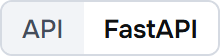
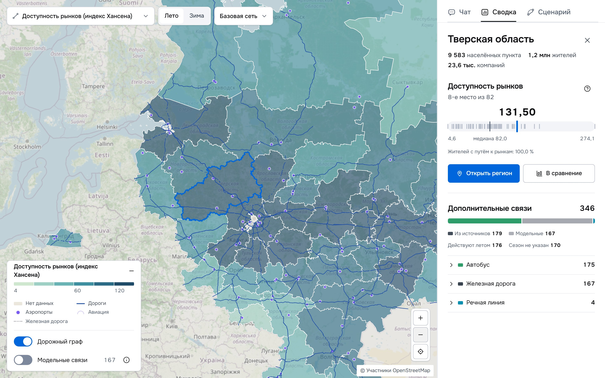
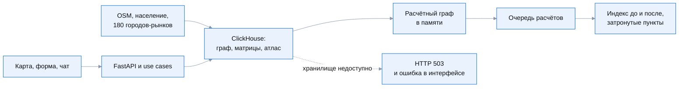

<p align="center">
<!-- readme:banner -->
<picture><source media="(prefers-color-scheme: dark)" srcset="docs/readme/banner.dark.png"></picture>
<!-- /readme:banner -->
</p>

<p align="center">Аналитик региональной политики меняет транспортную сеть на карте и сравнивает индекс региона до и после, затронутые пункты и жителей, которые потеряли выход к рынкам.</p>

<p align="center">
<!-- readme:buttons -->
<a href="#запуск"><picture><source media="(prefers-color-scheme: dark)" srcset="docs/readme/button-run.dark.png"></picture></a>
<a href="#попробовать-за-две-минуты"><picture><source media="(prefers-color-scheme: dark)" srcset="docs/readme/button-try.dark.png"></picture></a>
<a href="docs/README.md"><picture><source media="(prefers-color-scheme: dark)" srcset="docs/readme/button-docs.dark.png"></picture></a>
<!-- /readme:buttons -->
</p>

<p align="center">
<!-- readme:status -->
<a href="#как-это-работает"><picture><source media="(prefers-color-scheme: dark)" srcset="docs/readme/status-index.dark.png"></picture></a>
<a href="#ограничения"><picture><source media="(prefers-color-scheme: dark)" srcset="docs/readme/status-settlements.dark.png"></picture></a>
<a href="#как-это-работает"><picture><source media="(prefers-color-scheme: dark)" srcset="docs/readme/status-markets.dark.png"></picture></a>
<br>
<a href="#результаты"><picture><source media="(prefers-color-scheme: dark)" srcset="docs/readme/status-scenarios.dark.png"></picture></a>
<a href="#запуск"><picture><source media="(prefers-color-scheme: dark)" srcset="docs/readme/status-keys.dark.png"></picture></a>
<picture><source media="(prefers-color-scheme: dark)" srcset="docs/readme/status-locale.dark.png"></picture>
<!-- /readme:status -->
</p>

<p align="center">
<!-- readme:stack -->
<picture><source media="(prefers-color-scheme: dark)" srcset="docs/readme/stack-frontend.dark.png"></picture>
<picture><source media="(prefers-color-scheme: dark)" srcset="docs/readme/stack-types.dark.png"></picture>
<picture><source media="(prefers-color-scheme: dark)" srcset="docs/readme/stack-api.dark.png"></picture>
<br>
<picture><source media="(prefers-color-scheme: dark)" srcset="docs/readme/stack-storage.dark.png"></picture>
<picture><source media="(prefers-color-scheme: dark)" srcset="docs/readme/stack-graph.dark.png"></picture>
<picture><source media="(prefers-color-scheme: dark)" srcset="docs/readme/stack-run.dark.png"></picture>
<!-- /readme:stack -->
</p>

<p align="center">
<!-- readme:nav -->
<a href="#зачем-это"><picture><source media="(prefers-color-scheme: dark)" srcset="docs/readme/nav-why.dark.png"></picture></a>
<a href="#как-это-работает"><picture><source media="(prefers-color-scheme: dark)" srcset="docs/readme/nav-how.dark.png"></picture></a>
<a href="#попробовать-за-две-минуты"><picture><source media="(prefers-color-scheme: dark)" srcset="docs/readme/nav-try.dark.png"></picture></a>
<br>
<a href="#результаты"><picture><source media="(prefers-color-scheme: dark)" srcset="docs/readme/nav-results.dark.png"></picture></a>
<a href="#запуск"><picture><source media="(prefers-color-scheme: dark)" srcset="docs/readme/nav-run.dark.png"></picture></a>
<a href="#устройство"><picture><source media="(prefers-color-scheme: dark)" srcset="docs/readme/nav-layout.dark.png"></picture></a>
<a href="#ограничения"><picture><source media="(prefers-color-scheme: dark)" srcset="docs/readme/nav-limits.dark.png"></picture></a>
<!-- /readme:nav -->
</p>

<p align="center">

<br>
<sub>Локальный запуск с данными из ClickHouse, 12 ноября 2026 года. Лето, базовая сеть, выбрана Тверская область.</sub>
</p>

> **Пропуск в данных виден как ошибка, нулевой эффект остаётся нулём.** Если ClickHouse недоступен, API отвечает 503 и не подставляет файлы. Без матриц лаборатория `/scenarios` показывает ошибку и не рисует результатов. Удаление связи, которой нет в сценарии, отклоняется. Удаление летнего парома между Хоро и Нюрбой дало Якутии 0,00 %: паром не лежит на кратчайших путях, и ни один индекс пункта не изменился.

## Зачем это

Закрытый мост или новый рейс меняют время в пути далеко за пределами участка. Чтобы сравнить такие решения, нужен один показатель для всех регионов, посчитанный на одной сети и с одной нормировкой, и способ быстро пересчитать его для нового варианта.

11 ноября 2026 года мы закрыли через чат трассы М-10 и М-11 между Москвой и Санкт-Петербургом. Plexus нашёл регионы, через которые проходят трассы, и поставил четыре расчёта. Индекс Хансена Новгородской области упал на 34,71 %, Тверской на 30,52 %, Ленинградской на 1,45 %, Московской на 0,79 %. Изменилось 5 410 рёбер графа, каждый регион считался 68–75 секунд. [Как считаются закрытия и что проверено](docs/road-analysis.md).

Название от латинского plexus, «сплетение»: так анатомы называют узел, где сходятся нервы или сосуды. Три волны вокруг слова повторяют изохроны, линии равного времени в пути.

## Как это работает



| Индекс Хансена | Одна новая связь | Закрытие и ускорение дороги |
| --- | --- | --- |
| Для каждого населённого пункта складывается население 180 городов-рынков; вес рынка падает вдвое за каждые 2 часа пути. Регион получает среднее по населению, нормировка базовой сети одна для всех вариантов. | Время до рынков посчитано заранее. Новая двусторонняя связь обновляет его без полного поиска путей; для нового узла поиск выполняется один раз и кешируется. | Целый участок OSM закрывается в обе стороны или ускоряется на величину от 1 до 200 %, по умолчанию на 20 %. Каждый кандидат пересчитывается по 180 рынкам в фоновой очереди; расчёт можно остановить и продолжить. |
| Проверка: `etl/validate_indices.py` сверяет 12 выборочных формул отдельным вычислением. [Методика](docs/indices.md). | Проверка: быстрый результат отличается от полного пересчёта меньше чем на 0,000001 пункта. | Проверка: четыре прогона на реальных данных, 340–367 секунд на кандидата. [Протокол](docs/results/road-analysis-validation.json). |

Чат, ручная форма и поиск кандидатов вызывают одни и те же расчёты. Языковая модель выбирает инструмент и находит узлы графа, арифметику выполняет программа. [Чат и его инструменты](docs/chat.md).

## Попробовать за две минуты

Запустите Plexus по разделу [«Запуск»](#запуск). Первые ответы API после старта приходят медленнее, пока данные загружаются в память.

| Что сделать | Что увидите |
| --- | --- |
| Выберите на карте Тверскую область и откройте вкладку «Сводка» | Индекс Хансена 131,50, 8-е место из 82 при медиане 82,0; 9 583 населённых пункта, у всех жителей есть путь к рынкам |
| Откройте «Сценарий», затем «Дороги», выберите участок на карте и нажмите «Пересчитать индекс» | Индекс до и после, затронутые пункты и вновь изолированные жители; полный пересчёт занимает минуты |
| Напишите в чат: «Закрой М-10 и М-11 между Москвой и Санкт-Петербургом» | По расчёту на каждый регион, через который проходят трассы, с изменением индекса; около минуты на регион |

Значения первой строки сняты 12 ноября 2026 года для лета и базовой сети. Чат работает при серверной авторизации провайдера модели.

## Результаты

Каждая строка посчитана на реальных данных и имеет машинный протокол или запись с датой.

| Проверка | Результат | Предел | Протокол |
| --- | --- | --- | --- |
| Одна новая связь: быстрый путь против полного пересчёта | Расхождение меньше 0,000001 пункта | Один реальный пример; формула дополнительно проверена на малых графах | [Проверки](docs/evidence.md) |
| Закрытие кандидата Р-228, Волгоградская область, 10.11.2026 | Индекс с 93,794 до 93,124, 525 жителей вновь изолированы | По одному кандидату на регион и режим, 4 прогона | [JSON](docs/results/road-analysis-validation.json) |
| Ускорение на 20 %, Тыва, 10.11.2026 | Индекс с 30,485 до 30,642 | Глобальный оптимум отбора не доказан | Там же |
| Дорожный слой API, окно Владимирской области, 10.11.2026 | Ответ с 7,25 с до 0,57–0,81 с, все 64 779 рёбер окна на месте | Замер API, не частота кадров браузера | [JSON](docs/results/road-render-performance.json) |
| Чувствительность к составу рынков | Без Москвы оценка Московской области ниже на 66,6 %, медианная потеря по 82 регионам около 0,65 % | Один стресс-тест, полнота 180 городов не доказана | [JSON](docs/results/target-coverage-sensitivity.json) |

**Где проигрываем.** Закрытие или ускорение существующей дороги пересчитывает весь граф: 340–367 секунд на кандидата, порция из десяти кандидатов на реальных данных не измерена. Быстрый путь новой связи сверен с полным пересчётом на одном реальном примере. Проходимость дорог и действующие расписания внешне не проверялись.

<details>
<summary>Как воспроизвести</summary>

Производные кэши строятся из ClickHouse; команда проверяет базовые индексы 84 записей снимка и сохраняет матрицы до 180 рынков:

```sh
cd backend
PYTHONPATH=src uv run python precompute.py --data-dir ../data
uv run pytest tests/integration
```

Прогоны анализа дорог запускаются через `POST /api/v1/road-analyses`, статус и детали читаются через GET. Идентификаторы и длительности лежат в протоколе. Полная пересборка исходных индексов требует восстановленного набора источников: [данные и пайплайн](docs/data-pipeline.md).

</details>

## Запуск

Нужны Docker и загруженный снимок ClickHouse. Пароль задаётся в `.env.analytics`, пример переменных лежит в `.env.example`. В чистом клоне данных нет: первая загрузка описана в [описании хранилища](docs/clickhouse.md).

```sh
docker compose --env-file .env.analytics up --build -d
docker compose --env-file .env.analytics ps
```

Интерфейс: http://localhost:8080, API: http://localhost:8080/api/v1. Расчёты не используют платные API; чату нужна авторизация провайдера модели.

<details>
<summary>Локальная разработка</summary>

```sh
docker compose --env-file .env.analytics -f compose.analytics.yaml -p plexus-analytics up -d
set -a
source .env.analytics
set +a
cd backend
uv sync
GRAPH_DIR="$PWD/../data" CHAT_ENABLED=true uv run uvicorn app.main:create_app --factory --host 127.0.0.1 --port 8001
```

Во втором терминале:

```sh
cd frontend
npm ci
API_URL=http://127.0.0.1:8001 npm run dev -- --host 127.0.0.1 --port 5187
```

Интерфейс: http://127.0.0.1:5187. Подробности и переменные: [инструкция запуска](docs/running.md).

</details>

<details>
<summary>Проверки и переменные</summary>

```sh
cd frontend && npm run verify
```

```sh
cd backend
uv run ruff check .
uv run mypy .
uv run pytest tests/unit tests/integration
```

Интеграционным тестам нужны переменные из `.env.analytics`.

| Переменная | Назначение |
| --- | --- |
| `GRAPH_DIR` | Каталог производных кэшей; без него атлас работает, а расчёты маршрутов возвращают явную ошибку |
| `CHAT_ENABLED` | Включает чат |
| `ROAD_WORKERS` | Число процессов поиска путей, 1–48, по умолчанию 1 |
| `API_URL` | Куда Vite проксирует `/api` в разработке |
| `PORT` | Внешний порт интерфейса в Compose, по умолчанию 8080 |

Картинки этого README рисуются из токенов и знака продукта: `cd frontend && npm run readme`. Снимок карты: `npm run readme:hero` при запущенном приложении.

</details>

## Устройство

Фронтенд на React и MapLibre показывает только ответы API. Бэкенд на FastAPI разделён на слои domain, usecase, repository, adapter и controller; атлас, граф, матрицы и результаты расчётов хранятся в ClickHouse.

| Документ | Что внутри |
| --- | --- |
| [Архитектура расчёта](docs/architecture.md) | Путь запроса от карты до графа и где возможен отказ |
| [API](docs/api.md) | Эндпоинты, поля ответов и коды ошибок |
| [Национальные стресс-тесты](docs/road-stress.md) | Закрытия, потеря рынков и объезды по всей стране |
| [Полосность и время проезда](docs/road-capacity.md) | Как класс дороги, полосы и поток входят во время пути |
| [Перекрытие с переносом потока](docs/traffic-diversion.md) | Сценарная нагрузка, объезды и очередь |
| [Сценарная нагрузка](docs/synthetic-traffic.md) | Спрос от населения и жилой застройки |
| [Экономический эффект](docs/economic-appraisal.md) | Стоимость сэкономленного времени при заданных потоке и цене часа |
| [Потенциальная доступность](docs/potential-accessibility.md) | Сравнение методов и полнота расписаний |
| [Термины](docs/glossary.md) | Словарь транспортной доступности |
| [ИИ в проекте](docs/ai-register.md) | Какие задачи решал ИИ и как проверялись результаты |
| [Чат рядом с картой](docs/chat.md) | Агент, его инструменты и навыки |
| [Зависимости и права](docs/dependencies.md) | Версии, лицензии и условия данных |

## Ограничения

- **Модель не знает, ходит ли транспорт сейчас.** Отсутствие тега закрытия в OSM не доказывает проходимость дороги, работа исторических авиа- и водных линий не установлена. Неизвестная частота рейса заменена одним рейсом в неделю, это 84 часа ожидания.
- **Индекс описывает потенциальную доступность рынков.** Его рост не равен росту ВРП, выручки или дохода бюджета; потоки, окупаемость и стоимость вариантов не оценены.
- **Охват ограничен входным снимком:** 82 региона, 155 412 населённых пунктов и 128 053 288 жителей. Частичные записи Москвы и Севастополя исключены, Санкт-Петербург не представлен сопоставимой группой пунктов.

[Все ограничения и как их учитывать](docs/limitations.md).

---

<p align="center">
<!-- readme:footer -->
<picture><source media="(prefers-color-scheme: dark)" srcset="docs/readme/footer.dark.png"></picture>
<!-- /readme:footer -->
<br>
<sub>Team GoatWhistle, 2026. Licensed under <a href="LICENSE">MIT</a>. Дорожные данные © участники OpenStreetMap, ODbL.</sub>
</p>
